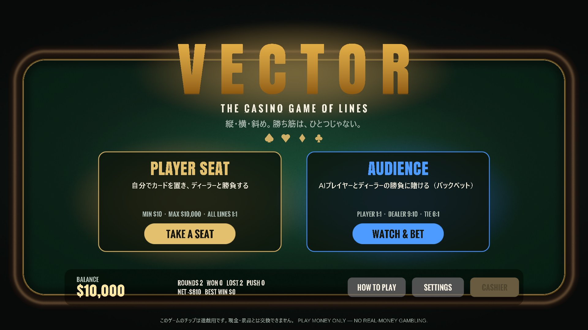

# VECTOR — The Casino Game of Lines

[](https://github.com/dorachan121/vector/actions/workflows/core.yml)

**縦（COLUMN）・横（ROW）・斜め（SLASH）。勝ち筋は、ひとつじゃない。**

3×3 の盤面にカードを置き、自分が選んだ種類のラインの合計でディーラーと勝負する、オリジナルのカジノテーブルゲームです。
6デッキのシュー、ハウスウェイ、検証済みの配当表、出目表（スコアボード）、サイドベットなど、実際のカジノのテーブルゲームと同じ考え方で作り直しました。



| ベット | ライン選択（戦略ヒント表示） |
|---|---|
|  |  |
| **配置** | **勝負** |
|  |  |

> このゲームのチップは遊戯用です。現金・景品とは交換できません。

---

## 📜 ルール

1. **ベット** — 15秒以内にチップを置いて DEAL（チップを置くとタイマーが動き、0秒で自動的に配られます）
2. **配札** — 盤面の中央に **ベクターカード**、手元に **手札4枚** が配られます
3. **ライン選択** — 手札を見て **ROW（横3本）/ COLUMN（縦3本）/ SLASH（斜め2本）** のどれかを選びます
4. **配置** — あなたが手札から1枚置く → ディーラーがシューから1枚引いて置く、を4回くり返して盤面を埋めます
5. **勝負** — あなたの得点は「選んだ種類で最も合計が大きいライン」、ディーラーの得点は「**残り2種類のうち高い方**」。高い方の勝ちです

- カードの点数は A=1、2〜10 は数字どおり、J=11、Q=12、K=13
- 同点は引き分け（PUSH）でメインベットは返金
- ライン選択と配置にはそれぞれ25秒の持ち時間があり、時間切れは戦略ヒントの手で自動進行します
- ディーラーには裁量がなく、決められた手順（**ハウスウェイ**）で置きます。ハウスウェイは各マスに置いた場合を最後まで試算し、ディーラーが最も勝ちやすいマスを選びます

### 2つの席

| 席 | 内容 |
|---|---|
| **PLAYER SEAT** | 自分でラインを選び、カードを置いてディーラーと勝負します |
| **AUDIENCE**（バックベット） | AI プレイヤーとディーラーの勝負に **PLAYER / DEALER / TIE** で賭けます（バカラ形式） |

どちらの席でも、中央のベクターカードと手札4枚の5枚で作るポーカー役に賭ける **BONUS** サイドベットが使えます。

---

## 💰 配当表と RTP

配当はすべて付属のシミュレーター（[`Tools/Simulator`](Tools/Simulator)）で検証しています。実際のゲームと同じ `RoundEngine` とハウスウェイでラウンドを繰り返して計測した値です。

### メインベット（PLAYER SEAT）— 全ライン 1:1、引き分けは返金

| 打ち方 | 勝ち | 引き分け | 負け | RTP |
|---|---:|---:|---:|---:|
| 戦略ヒントどおり（AI と同じ強さ） | 42.2% | 12.5% | 45.3% | **96.8%** ±0.6% |
| 1手先だけを見る打ち方 | 29.3% | 11.4% | 59.3% | 69.9% |
| でたらめ | 5.8% | 3.7% | 90.5% | 15.3% |

ブラックジャックやビデオポーカーと同じ「腕で RTP が変わる」スキルゲームです。最善に近い打ち方（戦略ヒント）でもハウスエッジ約3%が残るように設計しています。
（元の設計の「SLASH は 3倍」では、上手な打ち方で RTP が100%を超えてしまうため、全ライン 1:1 に統一しました）

### バックベット（AUDIENCE）— AI プレイヤーは戦略ヒントと同じ強さ

| ベット | 配当 | 的中率 | RTP |
|---|---:|---:|---:|
| PLAYER | 1:1（引き分けは返金） | 42.2% | 96.8% |
| DEALER | 9:10（引き分けは返金） | 45.3% | 98.6% |
| TIE | 6:1 | 12.5% | 87.6% |

### BONUS サイドベット（ミニマム $5 / マキシマム $1,000）

6デッキのシューから引く5枚の組み合わせ（約 2.4×10¹⁰ 通り）を全列挙した **厳密な** 値です。

| 役 | 配当 | 出現率 |
|---|---:|---:|
| ROYAL FLUSH | 1000:1 | 1 / 766,988 |
| STRAIGHT FLUSH | 250:1 | 1 / 85,221 |
| FIVE OF A KIND | 150:1 | 1 / 43,175 |
| FOUR OF A KIND | 40:1 | 1 / 600 |
| FULL HOUSE | 20:1 | 1 / 274 |
| FLUSH | 15:1 | 1 / 284 |
| STRAIGHT | 12:1 | 1 / 301 |
| THREE OF A KIND | 8:1 | 1 / 24 |
| TWO PAIR | 4:1 | 1 / 15 |
| **RTP** | | **95.65%** |

---

## 🎰 カジノとしての仕様

- **6デッキのシュー** — Fisher–Yates でシャッフルし、70〜80% の位置にカットカード、シャッフル後に1枚バーン
- **乱数** — 配札は暗号論的乱数（`RandomNumberGenerator`）。AI の先読みは速さ優先のシード付き乱数
- **テーブルリミット** — メイン $10〜$10,000、ボーナス $5〜$1,000
- **チップ** — $1 / $5 / $10 / $100 / $500 / $1K / $5K / $10K（UNDO・CLEAR・REBET・×2）
- **スコアボード** — バカラの罫線と同じビーズロード。シューが替わるとリセット
- **キャッシャー** — 手持ちがミニマムを下回ったら遊戯用チップを $10,000 まで補充
- **中断ラウンドの返金** — 配札後にアプリが落ちた場合、次回起動時にそのラウンドの賭け金を返金

---

## 🕹️ 操作

| 場面 | 操作 |
|---|---|
| ベット | 下のラックでチップの額面を選び、ベットエリアをクリック → DEAL |
| ライン選択 | ROW / COLUMN / SLASH のボタン（戦略ヒント ON なら勝率と ★推奨 を表示） |
| 配置 | 手札のカードをクリックして選び、置きたいマスをクリック |
| 設定 | 効果音の音量、高速ディール、戦略ヒントの ON/OFF |

---

## 🏗️ アーキテクチャ

```
Assets/Vector/
├── Scripts/
│   ├── Core/            Vector.Core（Unity 非依存のルールエンジン。noEngineReferences）
│   │   ├── Cards/       Card / Rank / Suit / Shoe
│   │   ├── Randomness/  IRandomSource / CryptoRandom / SeededRandom
│   │   ├── Board/       Board / Line / Lines / Scoring
│   │   ├── Poker/       PokerHand / PokerEvaluator
│   │   ├── Betting/     TableRules / Odds / BetLayout / Settlement / Bankroll …
│   │   ├── Round/       RoundEngine / RoundResult / Scoreboard …
│   │   ├── Session/     TableSession（ベット操作・引き落とし・払い戻し）
│   │   └── Strategy/    IDealerPolicy / HouseWay / PlayerAdvisor / GreedyPolicy / Playout …
│   └── Runtime/         Vector.Runtime（Unity 側）
│       ├── App/         GameContext / Log / Background / GuardedRoutine
│       ├── Persistence/ PlayerProfile / ProfileService / ProfileCodec / FileProfileStorage
│       ├── Audio/       Sfx / SfxSynth（効果音は実行時に合成）
│       ├── UI/          Foundation（Theme・Fonts・Art・Tween・Ui）/ Widgets（Dialog・Toast・Help・Settings）
│       ├── Table/       TableScene / TableDirector / BettingInput / TableFx / Seats / Views
│       └── Lobby/       LobbyScene / SeatCard
├── Tests/EditMode/      ルール・ベット・セッション・セーブのテスト（60件）
├── Scenes/              Lobby / Table（どちらも起点コンポーネントを1つ置くだけ）
└── Fonts/               Anton / Oswald（SIL Open Font License）
Tools/
├── Simulator/           配当表の検証ツール（.NET、Core のソースを共有）
└── CoreTests/           Unity なしで Core のテストを実行（CI 用）
```

### 設計方針

| 原則 | 具体例 |
|---|---|
| **単一責任 (S)** | ルール（`RoundEngine`）・ベット操作（`TableSession`）・進行（`TableDirector`）・画面配置（`TableView`）・演出（`TableFx`）・文言（`Labels`）を分離 |
| **開放閉鎖 (O)** / **リスコフ (L)** | 席の判断は `IPlayerSeat`（`HumanSeat` / `AiSeat`）、ディーラーは `IDealerPolicy`、保存先は `IProfileStorage` で差し替え可能 |
| **インターフェース分離 (I)** | 各インターフェースはメソッド1〜3個の最小構成 |
| **依存性逆転 (D)** | `RoundEngine` は乱数・ディーラー方針を抽象で受け取り、組み立ては `TableScene`（コンポジションルート）だけが行う |
| **KISS** | 画像やプレハブを持たず、UI・カード・チップ・効果音をコードで生成。DI コンテナやイベントバスは導入しない |
| **YAGNI** | 使わない機能・メンバーは置かない（旧スクリプト・旧アセット・TMP サンプルは削除） |
| **DRY** | 配当の数値は `TableRules` だけが持ち、配当表・ヘルプ・フェルトの印字はそこから生成 |

### 堅牢性・保守性・運用性

- **フェイルセーフ** — 1ラウンドを `GuardedRoutine` で包み、想定外の例外が起きてもゲームが固まらず、ラウンドを無効にして賭け金を返金（3回連続で失敗したらロビーへ）
- **セーブデータ** — HMAC-SHA256 で改ざん・破損を検知、一時ファイル経由の原子的な書き込み、1世代バックアップから自動復旧、読み込んだ値は範囲チェック。保存先は `Application.persistentDataPath`（旧版はビルドに含まれる `Assets/Data.json` に書き込んでいた）
- **スレッド** — AI の先読みはワーカースレッドで計算し、描画を止めない。Core は Unity API に触れないのでスレッド安全に使える
- **ログ** — `Log.Info` はリリースビルドでコンパイル時に除去
- **CI** — GitHub Actions で Core のテスト、ボーナスの厳密 RTP、メインゲームのスモークシミュレーションを実行

---

## 🛠️ 開発

- **Unity** 6000.6.6f1（uGUI / TextMesh Pro）
- **対象** Windows / Android（横向き）

### テスト

```bash
# Unity: Window > General > Test Runner > EditMode（60件）
# Unity なし（Core のみ・47件）
dotnet test Tools/CoreTests
```

### 配当の検証

```bash
cd Tools/Simulator
dotnet run -c Release -- bonus                         # ボーナスの厳密な RTP
dotnet run -c Release -- main 96000 advisor            # 戦略ヒントどおりに打った場合
dotnet run -c Release -- main 48000 greedy             # 1手先だけ見る打ち方
dotnet run -c Release -- main 24000 advisor 1 1:1      # 配当を変えて試す（最後の引数がメインの配当）
```

---

## 🔄 旧バージョン（2025年4月）からの主な変更

| 旧バージョンの課題 | 対応 |
|---|---|
| 約1,300行の `gameManager` にすべての処理が集中 | Core（ルール）と Runtime（表示）に分け、1ファイル1型・責務ごとのフォルダに再構成 |
| 残高チェックがなく、所持金がマイナスになる（セーブに `-8080`） | `Bankroll` / `TableSession` で残高・リミットを検証、セーブ値も範囲チェック |
| 偏りのあるシャッフル、同じカード判定の繰り返し | Fisher–Yates ＋ 暗号論的乱数、6デッキのシュー |
| ディーラーがランダムに置くだけで、上手に打つとプレイヤーが大幅に有利（シミュレーションで RTP 160% 超） | ハウスウェイと「残り2種類の高い方」ルールで、最善手でもハウスエッジ約3% |
| 引き分け時の精算ミス、毎フレームのセーブ | 精算を `Settlement` に一本化、セーブは配札時と精算時だけ |
| ベット操作は額面の送りと全額取消のみ、タイマーは常に15秒 | チップラック、UNDO / CLEAR / REBET / ×2、タイマーはチップを置いてから動く |

---

## 👤 作者

- **名前:** 澤井直輝
- **GitHub:** https://github.com/orgs/sawai-naoki-portfolio
- **連絡先:** naoki.sawai1201@gmail.com

<details>
<summary>オリジナル版（14日間で制作）の開発記録</summary>

来る2030年、新たなエンターテイメントの潮流となるであろう国内カジノ市場。
その未来図に触発され、単に既存のゲームを模倣するのではなく、プレイヤーに真新しい興奮と没入感を提供すべく、独自の「新感覚カジノゲーム」の創造を決意しました。

このプロジェクトは、プログラミング（C#）やUnityという新たな技術領域への挑戦であると同時に、私自身のゲームデザイン哲学と、細部へのこだわりを形にするための、まさに「作品創り」そのものでした。
開発において最も心を砕いたのは、プレイヤーが直感的かつ心地よくゲームの世界に没入できる体験の設計です。

インターフェースの一つひとつの配置、ボタンを押した際のわずかな反応、視覚的なエフェクトのタイミングに至るまで、「どうすればプレイヤーはもっと心地よく感じるか」「どうすればもっとゲームの世界に引き込まれるか」を徹底的に自問自答し、検討を重ねました。
目指したのは、単に「機能する」のではなく、プレイヤーの感性に響き、記憶に残る原体験を提供することです。

また、プレイヤーが積み重ねた時間と情熱の証である「ポイント」という成果を、単なるデータとしてではなく、プレイヤーの軌跡として大切に扱いたいと考えました。

その想いを実現するため、データの永続化は必須と判断し、JSON形式によるセーブ機能を実装しました。
これにより、プレイヤーは安心してゲームを中断でき、いつでも自身の築き上げた世界に戻ってくることができます。これは、プレイヤーとの長期的な関係性を築くための、ささやかながら重要な配慮であると信じています。

14日間という限られた時間でしたが、それはまさにアイデアを練り上げ、理想とする体験を追求し続けた、濃密な創造の時間でした。

技術的な制約の中で、いかにしてコンセプトを最大限に表現するか、プレイヤーに最高の瞬間を提供できるか。その一点に情熱を注ぎ込み、試行錯誤を繰り返しながら、納得のいく形を追求し続けました。

このゲームは、単なる学習成果ではなく、
私の**「プレイヤーに最高の体験を届けたい」という想いと、細部へのこだわりを結晶させた作品**です。
この創造のプロセスを通じて得た、技術的な知見はもちろんのこと、コンセプトを深く掘り下げ、ユーザーの心に響く体験をデザインする力こそが、私の強みであると自負しております。

</details>

---

## 📄 ライセンス

All rights reserved.
同梱フォント Anton / Oswald は SIL Open Font License 1.1（[`Assets/Vector/Fonts`](Assets/Vector/Fonts) のライセンス文書を参照）。
