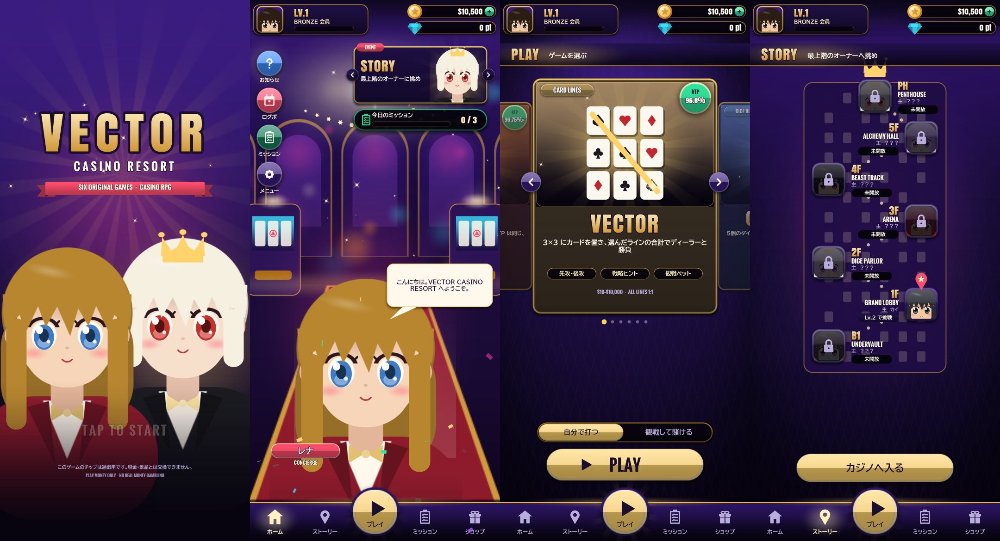
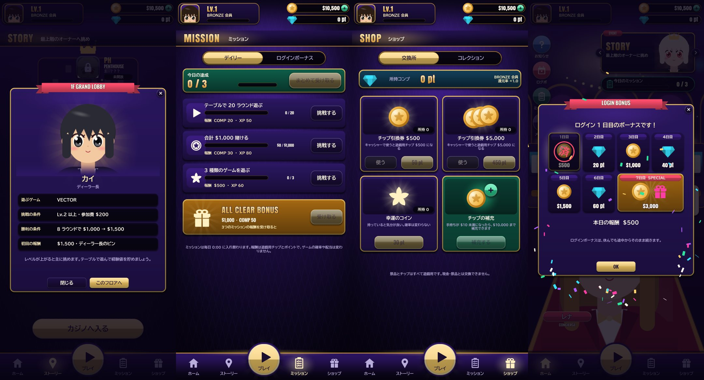
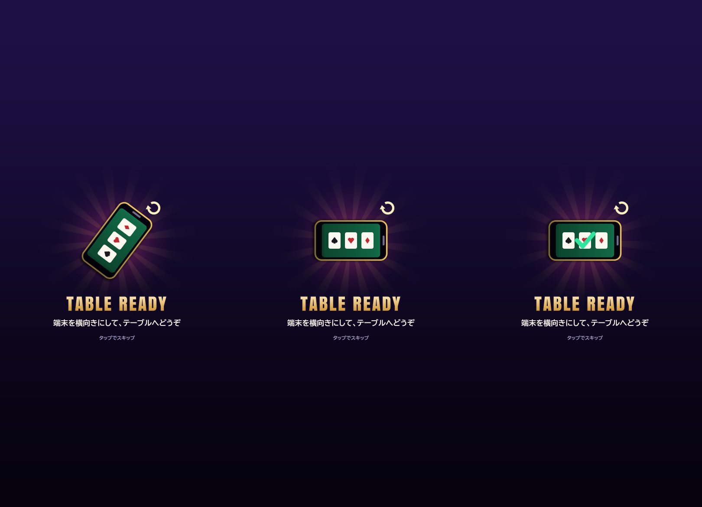
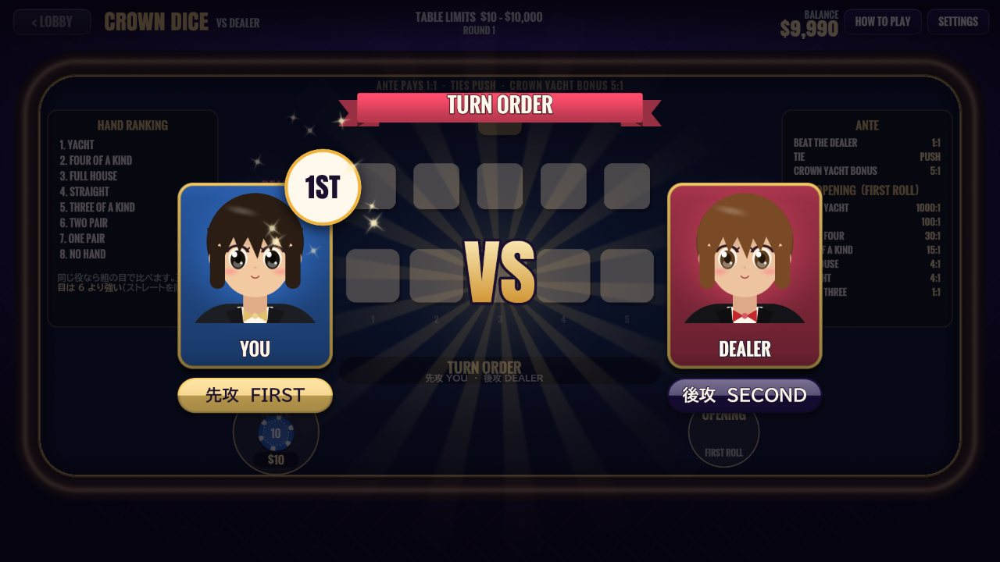
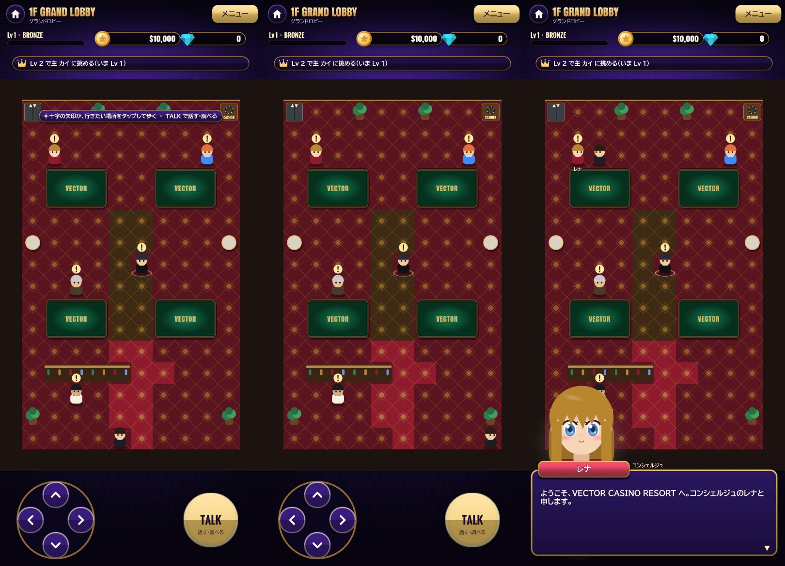
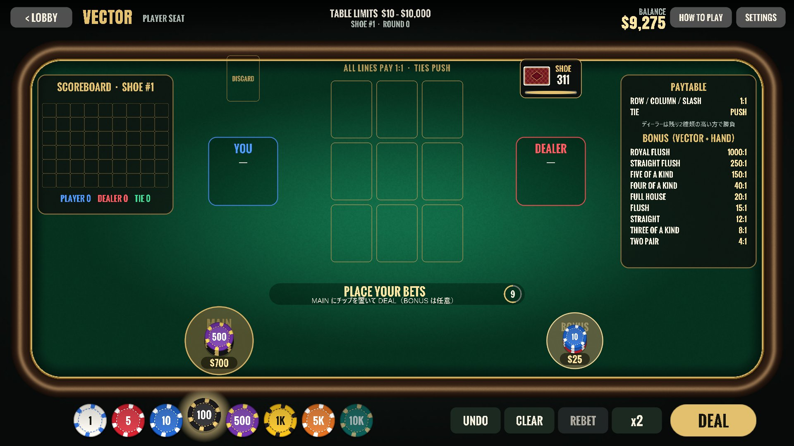
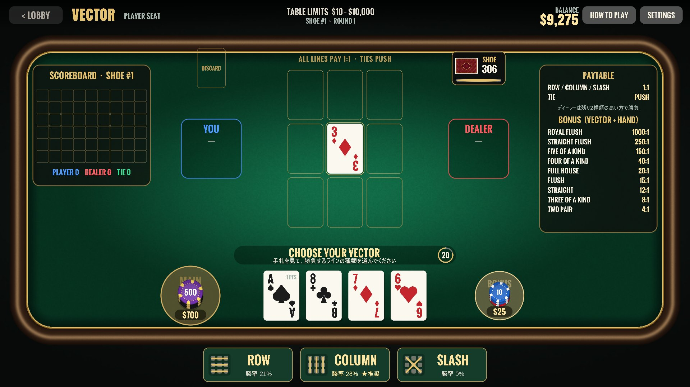
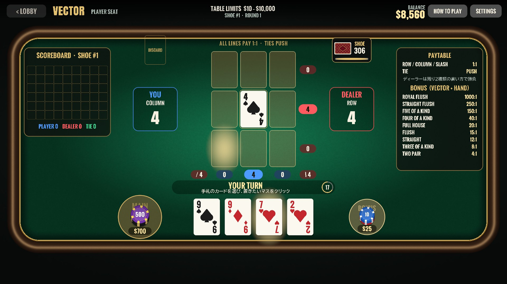
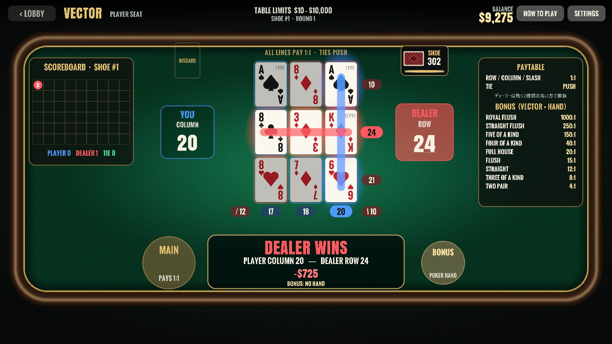

# VECTOR CASINO RESORT — 6つのオリジナルカジノゲームとカジノ RPG

[](https://github.com/dorachan121/vector/actions/workflows/core.yml)

**確率をすべて公開した、正直なカジノ。** 既存のゲームの焼き直しではない、6つのオリジナルのカジノゲームと、
そのカジノの中を歩いてフロアの主たちに挑む **ストーリーモード（カジノ RPG）** を収録しています。

どのゲームも、実際のカジノと同じ考え方で作っています。配当表は付属のシミュレーターで検証し（厳密に計算できるものは全列挙・動的計画法で求めた **厳密値**）、
最善を尽くしてもハウス（カジノ側）がわずかに有利になるように設計しています。乱数は暗号論的乱数、テーブルリミット・中断時の返金・リアリティチェックも備えています。



> このゲームのチップは遊戯用です。現金・景品とは交換できません。

---

## 🎲 ゲーム一覧

| ゲーム | ジャンル | ひとことで | RTP |
|---|---|---|---:|
| **VECTOR** | カード × ライン | 3×3 にカードを置き、選んだ種類のラインの合計でディーラーと勝負 | 96.8%（最善手） |
| **CROWN DICE** | ダイス × 決闘 | 5個のダイスを振り直して、後から振るディーラーに勝つ。王冠の目は 6 より強い | **96.852%**（厳密） |
| **COLOSSEUM** | カード × バトル | 獣の「予告」を見て STRIKE か GUARD を選び、体力を削り合う | **96.712%**（厳密） |
| **FOUR BEASTS DERBY** | カード × レース | めくったスートの神獣が1歩進むレース。オッズは着順の確率から厳密計算 | 単勝 95.7% / 馬単 96.6%（厳密・平均） |
| **ALCHEMIA** | 融合 × スロット | 同じ元素が3つつながると融合して位が上がる、連鎖型のビデオスロット | 96.92% ±0.19%（1.2億回） |
| **DELVE** | 迷宮 × 引き際 | 扉を選んで迷宮を潜り、いつ引き返すかを決める | **96.75〜97.00%**（厳密・どこで引き返しても） |

「腕で RTP が変わる」スキルゲーム（VECTOR / CROWN DICE / COLOSSEUM）には、設定で ON にできる **戦略ヒント** があります。
CROWN DICE と COLOSSEUM のヒントは、後ろ向き帰納・動的計画法で求めた **厳密な最善手** です。

---

## 🏠 ホーム画面（縦向き）

ホームとストーリーモードは **縦持ち前提** で作った画面、ゲームのテーブルは **横向き** で遊びます。起動すると最初の1回だけタイトルが出て、明けるとホームになります。
上部はプレイヤーの札（顔・Lv・会員ランク・経験値）と所持金・コンプ、下は日本語の名前のタブで、真ん中の **プレイ** はバーから盛り上がった大きなボタンです。

| タブ | 中身 |
|---|---|
| **ホーム** | カジノのロビー（アーチ・シャンデリア・スロット台・赤い絨毯）に立つコンシェルジュのレナ。触ると弾んで、ミッションの達成や主に挑めることを教えてくれる。左にお知らせ・ログボ・ミッション・メニュー、右上にイベントのバナーと今日のミッションの進み具合 |
| **ストーリー** | カジノの塔を下から登る地図。各フロアの主の顔の札と進み具合（制覇・挑戦できる・必要なレベル・未開放）、いま目指すフロアの印。フロアを押すと主の立ち絵・挑戦の条件・初回の報酬を見て、そのフロアへ入れる |
| **プレイ** | ゲームの大きなキービジュアルのカードを横にはらって選ぶ（矢印・点でも送れる）。ジャンル・RTP・特徴の札・テーブルの条件。VECTOR は「自分で打つ／観戦して賭ける」を選び、親指の届く下端の PLAY で着席 |
| **ミッション** | 「デイリー｜ログインボーナス」の切り替え。今日の3つのミッション・まとめて受け取る・すべて達成のボーナスと、7日で1巡する暦 |
| **ショップ** | 「交換所｜コレクション」の切り替え。コンプと景品の交換、引換券の使用、手持ちがミニマム未満のときの補充、主から受け取った記念品の一覧 |



- **ログインボーナス** — 1日1回、遊戯用チップかコンプ。休んでもリセットされず、端末の日付を戻しても二重には受け取れない
- **デイリーミッション** — 「20ラウンド遊ぶ」「合計 $1,000 賭ける」「3種類のゲームを遊ぶ」など。報酬は遊戯用チップ・コンプ・経験値だけで、ゲームの確率や配当は変わらない
- ガチャ（確率で当たりが決まる有料・無料のくじ）はありません

### テーブルへの行き来と、ラウンドの始まりの演出

| | |
|---|---|
|  | テーブルへ移るとき、暗転した画面で端末の絵が縦から横へ回り「TABLE READY」と案内します。スマートフォンでは **端末を横に持ち替えると** 画面が回ってテーブルが明けます（タップか数秒で先へ進む）。ホームへ戻るときは縦向きに戻るよう案内します |
|  | 先攻・後攻のある **VECTOR / CROWN DICE / COLOSSEUM** は、左右から2人の札が滑り込み、回る「1ST」のボタンが先攻の側に置かれて始まります。テーブルの最初のラウンドは大きく、以降は短い帯だけ。順番はゲームの規則で決まっていて（いつもプレイヤーが先）、演出はそれを見せるだけです |

賭け金の5倍以上勝つと、回る光と降り注ぐ金貨の **BIG WIN** が出ます（操作は止めません）。

---

## 🗺️ ストーリーモード（カジノ RPG）

開業したばかりの VECTOR CASINO RESORT に、オーナーのゼロから招待状が届くところから始まります。
カジノの中を歩き、人と話し、テーブルで腕を磨きながら、各フロアの「主」に挑んで最上階を目指します。
フロアの画面は縦向きで、見取り図も縦画面用の 12×18 マス（横幅が画面にちょうど収まり、縦は主人公に合わせて流れる）。
上にいまの目標、下に十字の矢印と TALK ボタン、会話では話す人の立ち絵が出ます。



| フロア | ゲーム | 主 | 挑戦の条件（参加費 → 挑戦用チップ $1,000 を目標額へ） |
|---|---|---|---|
| 1F グランドロビー | VECTOR | ディーラー長 カイ | Lv 2 · $200 · 8ラウンドで $1,500 |
| 2F ダイスパーラー | CROWN DICE | ダイスの女王 レイナ | Lv 3 · $300 · 8ラウンドで $1,600 |
| 3F アリーナ | COLOSSEUM | 無敗の闘技王 ガルド | Lv 5 · $400 · 6ラウンドで $1,700 |
| 4F ビーストトラック | DERBY | 確率の胴元 トキ | Lv 7 · $500 · 6レースで $1,800 |
| 5F 錬金の間 | ALCHEMIA | 錬金術師 ミラ | Lv 9 · $600 · 50スピンで $1,500 |
| B1 アンダーヴォールト | DELVE | 迷宮の番人 モス | Lv 11 · $800 · 8回潜って $2,500 |
| ペントハウス | COLOSSEUM（THE HOUSE） | オーナー ゼロ | Lv 13 · $1,000 · 1戦で $2,000 |

- **主の挑戦** — トーナメント形式。参加費を払うと所持金とは別の挑戦用チップを受け取り、決められたラウンド数で目標額に届けば勝ち。
  はじめて勝つと賞金・記念品・次のフロアが手に入ります。ゲームの配当や確率は通常のテーブルとまったく同じです
- **会員ランクとコンプ** — 経験値・レベル・会員ランク（BRONZE〜BLACK）・コンプポイントは **賭けた額だけ** で貯まり、勝ち負けやゲームの確率には一切影響しません。
  コンプはキャッシャーで遊戯用チップの引換券と交換できます
- **クエスト** — 登場人物から依頼を受けます（「SLASH で勝つ」「YACHT を出す」「馬単を当てる」など全15種）
- **27人の登場人物** — 頭の上の「!」は話すことがある人、「?」は報酬を受け取れる人
- 挑戦の勝てる確率は、シミュレーター（`challenge`）で強気に賭ける打ち方を試し、25〜60% ほどになるように決めています

---

## 🃏 VECTOR

**縦（COLUMN）・横（ROW）・斜め（SLASH）。勝ち筋は、ひとつじゃない。**

| ベット | ライン選択（戦略ヒント表示） |
|---|---|
|  |  |
| **配置** | **勝負** |
|  |  |

### ルール

1. **ベット** — 15秒以内にチップを置いて DEAL（チップを置くとタイマーが動き、0秒で自動的に配られます）
2. **配札** — 盤面の中央に **ベクターカード**、手元に **手札4枚** が配られます
3. **ライン選択** — 手札を見て **ROW（横3本）/ COLUMN（縦3本）/ SLASH（斜め2本）** のどれかを選びます
4. **配置** — あなたが手札から1枚置く → ディーラーがシューから1枚引いて置く、を4回くり返して盤面を埋めます
5. **勝負** — あなたの得点は「選んだ種類で最も合計が大きいライン」、ディーラーの得点は「**残り2種類のうち高い方**」。高い方の勝ちです

- カードの点数は A=1、2〜10 は数字どおり、J=11、Q=12、K=13
- 同点は引き分け（PUSH）でメインベットは返金
- ライン選択と配置にはそれぞれ25秒の持ち時間があり、時間切れは戦略ヒントの手で自動進行します
- ディーラーには裁量がなく、決められた手順（**ハウスウェイ**）で置きます。ハウスウェイは各マスに置いた場合を最後まで試算し、ディーラーが最も勝ちやすいマスを選びます

#### 2つの席

| 席 | 内容 |
|---|---|
| **PLAYER SEAT** | 自分でラインを選び、カードを置いてディーラーと勝負します |
| **AUDIENCE**（バックベット） | AI プレイヤーとディーラーの勝負に **PLAYER / DEALER / TIE** で賭けます（バカラ形式） |

どちらの席でも、中央のベクターカードと手札4枚の5枚で作るポーカー役に賭ける **BONUS** サイドベットが使えます。

---

### 配当表と RTP

配当はすべて付属のシミュレーター（[`Tools/Simulator`](Tools/Simulator)）で検証しています。実際のゲームと同じ `RoundEngine` とハウスウェイでラウンドを繰り返して計測した値です。

#### メインベット（PLAYER SEAT）— 全ライン 1:1、引き分けは返金

| 打ち方 | 勝ち | 引き分け | 負け | RTP |
|---|---:|---:|---:|---:|
| 戦略ヒントどおり（AI と同じ強さ） | 42.2% | 12.5% | 45.3% | **96.8%** ±0.6% |
| 1手先だけを見る打ち方 | 29.3% | 11.4% | 59.3% | 69.9% |
| でたらめ | 5.8% | 3.7% | 90.5% | 15.3% |

ブラックジャックやビデオポーカーと同じ「腕で RTP が変わる」スキルゲームです。最善に近い打ち方（戦略ヒント）でもハウスエッジ約3%が残るように設計しています。
（元の設計の「SLASH は 3倍」では、上手な打ち方で RTP が100%を超えてしまうため、全ライン 1:1 に統一しました）

#### バックベット（AUDIENCE）— AI プレイヤーは戦略ヒントと同じ強さ

| ベット | 配当 | 的中率 | RTP |
|---|---:|---:|---:|
| PLAYER | 1:1（引き分けは返金） | 42.2% | 96.8% |
| DEALER | 9:10（引き分けは返金） | 45.3% | 98.6% |
| TIE | 6:1 | 12.5% | 87.6% |

#### BONUS サイドベット（ミニマム $5 / マキシマム $1,000）

6デッキのシューから引く5枚の組み合わせ（約 2.4×10¹⁰ 通り）を全列挙した **厳密な** 値です。

| 役 | 配当 | 出現率 |
|---|---:|---:|
| ROYAL FLUSH | 1000:1 | 1 / 766,988 |
| STRAIGHT FLUSH | 250:1 | 1 / 85,221 |
| FIVE OF A KIND | 150:1 | 1 / 43,175 |
| FOUR OF A KIND | 40:1 | 1 / 600 |
| FULL HOUSE | 20:1 | 1 / 274 |
| FLUSH | 15:1 | 1 / 284 |
| STRAIGHT | 12:1 | 1 / 301 |
| THREE OF A KIND | 8:1 | 1 / 24 |
| TWO PAIR | 4:1 | 1 / 15 |
| **RTP** | | **95.65%** |

---

## 👑 CROWN DICE

1. ANTE にチップを置いて ROLL。金色の **王冠のダイス** が振られ、このラウンドの「王冠の目」が決まります（王冠の目は 6 より強い）
2. あなたが5個を振り、残す目を選んで最大2回振り直します（いつでも STAND）
3. ディーラーは **あなたの確定した手を見てから** 最大3回振ります。振り方は決まった手順（ハウスウェイ）で、プレイヤーへの払い戻しの期待値が最も小さくなる目を残します
4. 役（YACHT > FOUR OF A KIND > FULL HOUSE > STRAIGHT > THREE OF A KIND > TWO PAIR > ONE PAIR）が強い方の勝ち。同じ役は組になった目の強さで比べ、まったく同じなら引き分け

| ベット | 配当 |
|---|---|
| ANTE（$10〜$10,000） | 勝ち 1:1 · 引き分けは返金 · **王冠の目の YACHT** を作ると 5:1 のボーナスを上乗せ（最強の手なので負けない） |
| OPENING（$5〜$1,000、最初の5個だけで決まるサイドベット） | 王冠の YACHT 1000:1 · YACHT 100:1 · 王冠のフォーカード 30:1 · フォーカード 15:1 · フルハウス 4:1 · ストレート 4:1 · 王冠のスリーカード 1:1 |

- 252 通りの手 × 462 通りの残し方を後ろから解いた **厳密な最善戦略** で ANTE の RTP は **96.852%**（王冠の目ごとに 96.84〜96.89%）、OPENING は **94.920%**

## ⚔️ COLOSSEUM

- あなたの体力 30、獣の体力 42。毎ターン、獣が次の一撃の **予告カード** を見せます
- **STRIKE** — カードを1枚引き、その点数だけ獣にダメージ（K は会心の一撃で 26）。倒しきれなければ予告どおりのダメージを受ける
- **GUARD** — カードを1枚引き、予告より大きければ差だけ反撃、小さければ差だけ被弾
- 獣を倒せば 1:1。全状態の勝率を動的計画法で解いた最善手で **RTP 96.712%**（勝率 48.36%）。戦略ヒントは STRIKE / GUARD それぞれの厳密な勝率を表示

## 🐉 FOUR BEASTS DERBY

- 四神（♠ 青龍 / ♥ 朱雀 / ♦ 白虎 / ♣ 玄武）が、1組52枚からめくったカードのスートの分だけ1歩ずつ進むレース。距離（8〜12歩）とゲート（0〜3歩前）はレースごとに抽選
- **WIN（単勝）$10〜$10,000** と **EXACTA（馬単）$5〜$1,000**
- 出走表が決まると、残りのカードの枚数から着順の確率を **厳密に計算**（メモ化した再帰で1レース約2ms）し、オッズは「払戻率97% ÷ 的中確率」を0.1倍単位で切り捨て。どの馬券も RTP 97% 以下（平均 単勝 95.7% / 馬単 96.6%）。レース中は各レーンの「今からの勝つ確率」をライブ表示

## ⚗️ ALCHEMIA

- 6×5 の錬成盤に5つの元素が降り、同じ元素が縦横に3つ以上つながると **融合** して位が1つ上がる（素 → 晶 → 霊薬 → 秘宝 → 賢者の石）
- 位3以上を作ると配当（霊薬 x1 · 秘宝 x6 · 賢者の石 x30、塊が1個増えるごとに +0.5倍）。賢者の石がさらに融合すると **大錬成 x300**。連鎖の段ごとに x1 / x1 / x1 / x2 / x2 / x3 の倍率。上限は賭け金の 5,000 倍
- 1.2億回のスピンで **RTP 96.92% ±0.19%**（95%信頼区間）、当たりは約4.3回に1回

## 🚪 DELVE

- 深さごとの扉から1枚を開け、宝なら次の深さへ、魔物なら没収。1つ以上抜けたら、いつでも CASH OUT でその深さの倍率を受け取って引き返せる
- 扉と魔物: 4/1 · 4/1 · 3/1 · 3/1 · 2/1 · 2/1 · 3/2 · 3/2 · 4/3 · 4/3（最深部 B10 で x2,234.88）
- 倍率は「払戻率 ÷ その深さまで生き残る確率」を 0.01倍単位で切り捨て。**どこで引き返しても RTP は 96.75〜97.00%** で、打ち方による有利・不利はありません

---

## 🎰 カジノとしての仕様（全ゲーム共通）

- **乱数** — カード・ダイス・扉・スロットはすべて暗号論的乱数（`RandomNumberGenerator`）。AI の先読みだけは速さ優先のシード付き乱数
- **テーブルリミット** — ゲームごとのミニマム・マキシマムと、サイドベットの上限
- **チップ** — $1 / $5 / $10 / $100 / $500 / $1K / $5K / $10K（UNDO・CLEAR・REBET・×2）。チップを置くとベットの持ち時間が動き出す
- **キャッシャー** — 手持ちがミニマムを下回ったら遊戯用チップを $10,000 まで補充
- **中断した勝負の返金** — 勝負の途中でアプリが落ちた・想定外の障害が起きた場合、その勝負を無効にして賭け金を返金（主の挑戦も同じく参加費を返金）
- **リアリティチェック** — 30分ごとにプレイ時間とそのセッションの収支を知らせ、ロビーに戻るか続けるかを選べる
- **スマートフォン** — ホーム・ストーリーは縦向き、テーブルは横向きに固定（向きが変わるときは回転を案内）、ノッチ・パンチホールを避けるセーフエリア対応、60fps 描画。勝負中は画面を消灯させず、アプリを裏に回しても持ち時間は減らない

---

## 🕹️ 操作

| 場面 | 操作 |
|---|---|
| ベット | 下のラックでチップの額面を選び、ベットエリアをクリック → DEAL / ROLL / START など |
| ホーム | 下のタブでホーム／ストーリー／プレイ／ミッション／ショップを切り替え。プレイのカードは横にはらって選ぶ。Esc（Android の戻る）でホームへ、ホームなら終了の確認 |
| ストーリーモードの移動 | 画面下の十字の矢印・矢印キー・WASD、または行きたいマスをタップ（クリック）。人やテーブルをタップすると、そこまで歩いて話しかける |
| 話す・調べる | TALK ボタン / Space / Enter / Z（向いている先の人・テーブル・エレベーター・キャッシャー） |
| メニュー | Esc または MENU（会員の状態・クエスト・持ち物・設定） |
| 設定 | 効果音の音量、高速ディール、戦略ヒントの ON/OFF |
| キーボード（テーブル） | Space / Enter = 開始、Backspace = UNDO、数字キー = 各ゲームの選択肢、Esc = ダイアログを閉じる → 離席。Android の戻るボタンも同じ |

---

## 🏗️ アーキテクチャ

```
Assets/Vector/
├── Scripts/
│   ├── Core/                 Vector.Core（Unity 非依存のルールエンジン。noEngineReferences）
│   │   ├── Common/           全ゲーム共通: Cards / Randomness / Money（Bankroll・Odds）/
│   │   │                     Wagering（BetBoard・IBetLimits・WagerCheck・WagerSession・SpotResult）/ ResponsibleGaming
│   │   ├── Games/            ゲームごとのルール・エンジン・厳密解ソルバー
│   │   │   ├── Vector/       Betting（TableRules・TableLimits）/ Board / Poker / Round / Strategy
│   │   │   └── Crown/ Colosseum/ Derby/ Delve/ Alchemia/
│   │   └── Rpg/              ストーリーモードの規則: RpgSession / RpgState / Progress / Quests / Items / Floors / Challenges /
│   │                         Daily（ログインボーナス・デイリーミッション）
│   ├── Runtime/              Vector.Runtime（Unity 側）
│   │   ├── App/              GameContext / GameCatalog / Startup / GuardedRoutine / Log
│   │   ├── Casino/           全ゲーム共通のテーブル: CasinoDirector（進行のテンプレート）/ CasinoView / WagerInput /
│   │   │                     財布（ProfileWallet・ChallengeWallet）/ ChallengeFlow / Views（チップ・HUD・ベットエリアなど）
│   │   ├── Games/            ゲームごとの画面と進行役: Vector/ Crown/ Colosseum/ Derby/ Delve/ Alchemia/
│   │   ├── World/            ストーリーモードのフロア: WorldDirector / Conversation / FloorActors / Views / Cast / Panels
│   │   ├── Story/            進み具合の保存（StoryProgress）・名前の表示（StoryNames）・フロアの並び・報酬の表示
│   │   ├── Lobby/            ホーム（縦向き）: LobbyScene（組み立て）/ Tabs（ホーム・ストーリー・プレイ・ミッション・ショップ）/
│   │   │                     Views（背景・ヘッダー・下のタブ・ゲームのカードとカルーセル・塔のフロア・暦・お知らせ・タイトル）
│   │   ├── Persistence/      PlayerProfile / ProfileService / ProfileCodec（HMAC）/ FileProfileStorage
│   │   ├── Audio/            Sfx / SfxSynth（効果音は実行時に合成）
│   │   └── UI/               Foundation（Ui・画面の形と向き・SceneFlow・Tween・Palette）/ Art（光沢・額縁・アイコン・立ち絵の部品）/
│   │                         Effects（回転・脈動・紙吹雪・金貨）/ Widgets（Dialog・報酬・回転の案内・通貨・ゲージ・バッジ・サブタブ）
│   └── Editor/               日本語フォントの焼き込み（文言が増えたら自動で作り直す）
├── Tests/EditMode/           ルール・厳密解・賭け金・RPG・セーブ・フォント網羅のテスト（129件）
├── Scenes/                   Lobby / Table / Crown / Colosseum / Derby / Delve / Alchemia / World（どれも起点コンポーネントを1つ置くだけ）
└── Fonts/                    Anton / Oswald / BIZ UDPGothic（SIL Open Font License）
Tools/
├── Simulator/                配当表・挑戦の検証ツール（.NET、Core のソースを共有）
└── CoreTests/                Unity なしで Core のテストを実行（CI 用）
```

名前空間は Core が `Vector.Core`（ゲームごとに `Vector.Core.Crown` など）、Runtime が `Vector.Game.*` です。フォルダの `Views` などは整理のためのもので、名前空間は親フォルダと同じです。

### 設計方針

| 原則 | 具体例 |
|---|---|
| **単一責任 (S)** | ルール（各 `*Engine`）・賭け金（`WagerSession`）・進行（`*Director`）・画面配置（`*View`）・演出・文言（`Labels` / `StoryNames` / `Cast`）を分離。会話の流れ（`Conversation`）と規則の判断（`RpgSession`）も別 |
| **開放閉鎖 (O)** | 全ゲームの進行は `CasinoDirector` のテンプレートメソッド。新しいゲームは `PlayRound` などを実装するだけで、ベット受付・精算・返金・離席・挑戦を受け継ぐ |
| **リスコフ (L)** | 所持金と挑戦用チップは `ITableWallet`（`ProfileWallet` / `ChallengeWallet`）で入れ替えても、テーブルはそのまま動く |
| **インターフェース分離 (I)** | `IBetLimits`・`IChipAccount`・`IRoundOutcome`・`IRandomSource` などはメソッド1〜4個の最小構成 |
| **依存性逆転 (D)** | エンジンは乱数・リミット・ディーラー方針を抽象で受け取り、組み立ては各シーンの起点（コンポジションルート）だけが行う |
| **KISS** | 画像やプレハブを持たず、UI・カード・ダイス・キャラクター・効果音をコードで生成。DI コンテナやイベントバスは導入しない。画面の向きは各シーンが `Ui.CreateScreen(name, ScreenShape)` で宣言するだけ |
| **YAGNI** | 使わない機能・メンバーは置かない。不要な using・使われないメンバーはビルドで検出する（下記） |
| **DRY** | 配当の数値は各ゲームの `*Rules` だけが持ち、配当表・ヘルプ・フェルトの印字はそこから生成。賭け金の管理・進行・入力・配当表の部品は全ゲームで共通 |

### 堅牢性・保守性・運用性

- **フェイルセーフ** — 1ラウンドを `GuardedRoutine` で包み、想定外の例外が起きてもゲームが固まらず、勝負を無効にして賭け金を返金（3回連続で失敗したら離席。主の挑戦中なら参加費も返金）
- **セーブデータ** — HMAC-SHA256 で改ざん・破損を検知、一時ファイル経由の原子的な書き込み、1世代バックアップから自動復旧。読み込んだ値は範囲チェックし、重複したクエストや知らない項目は取り除く
- **主の挑戦** — 決着はテーブルを離れる前に確定して保存。決着前にアプリが終わったら、次の起動時に参加費を返す（二重には返さない）
- **スレッド** — AI の先読みはワーカースレッドで計算し、描画を止めない。Core は Unity API に触れないのでスレッド安全に使える
- **静的解析** — `.editorconfig` で不要な using・使われない private メンバー・読まれないフィールド・使われない引数を警告にし、Tools のビルド（警告はエラー扱い）と CI で検出
- **CI** — GitHub Actions で Core のテスト、全ゲームの厳密な RTP、スロットと挑戦のシミュレーションを実行
- **ログ** — `Log.Info` はリリースビルドでコンパイル時に除去

---

## 🛠️ 開発

- **Unity** 6000.6.6f1（uGUI / TextMesh Pro）
- **対象** Windows / Android（横向き）

### テスト

```bash
# Unity: Window > General > Test Runner > EditMode（129件）
# Unity なし（Core のみ・114件）
dotnet test Tools/CoreTests
```

### 日本語フォント

画面の日本語は、同梱の BIZ UDPGothic から「ゲームで使う文字だけ」を焼き込んだ静的フォントで表示します（端末のフォントに依存しないので Android でも同じ見た目）。
画面の文言（Runtime の文字列リテラル）に新しい文字が増えると、**エディタの起動時とビルドの前に自動で作り直します**（アトラスの大きさも文字数から決定）。
手動ではメニュー **Vector / Rebuild Japanese Font**。焼き込み漏れはテスト（`JapaneseFontCoverageTests`）が検出します。

### 配当の検証

```bash
cd Tools/Simulator
dotnet run -c Release -- bonus                     # VECTOR ボーナスの厳密な RTP
dotnet run -c Release -- main 96000 advisor        # VECTOR を戦略ヒントどおりに打った場合
dotnet run -c Release -- crown                     # CROWN DICE の厳密な RTP（王冠の目ごと）とシミュレーション
dotnet run -c Release -- colosseum                 # COLOSSEUM の厳密な RTP とシミュレーション
dotnet run -c Release -- derby                     # DERBY の全出走表のオッズと RTP
dotnet run -c Release -- delve                     # DELVE の深さごとの倍率と RTP
dotnet run -c Release -- alchemia 120000000        # ALCHEMIA の RTP（1.2億回）
dotnet run -c Release -- challenge 2000            # ストーリーモードの挑戦の勝率
```

---

## 🔄 旧バージョン（2025年4月）からの主な変更

| 旧バージョンの課題 | 対応 |
|---|---|
| 約1,300行の `gameManager` にすべての処理が集中 | Core（ルール）と Runtime（表示）に分け、1ファイル1型・責務ごとのフォルダに再構成 |
| 残高チェックがなく、所持金がマイナスになる（セーブに `-8080`） | `Bankroll` / `WagerSession` で残高・リミットを検証、セーブ値も範囲チェック |
| 偏りのあるシャッフル、同じカード判定の繰り返し | Fisher–Yates ＋ 暗号論的乱数、6デッキのシュー |
| ディーラーがランダムに置くだけで、上手に打つとプレイヤーが大幅に有利（シミュレーションで RTP 160% 超） | ハウスウェイと「残り2種類の高い方」ルールで、最善手でもハウスエッジ約3% |
| 引き分け時の精算ミス、毎フレームのセーブ | 精算を `Settlement` に一本化、セーブは配札時と精算時だけ |
| ベット操作は額面の送りと全額取消のみ、タイマーは常に15秒 | チップラック、UNDO / CLEAR / REBET / ×2、タイマーはチップを置いてから動く |
| ゲームは VECTOR の1つだけ | 5つの新ゲームとストーリーモードを追加し、6ゲームが同じテーブルの土台（`CasinoDirector`）を共有 |

---

## 👤 作者

- **名前:** 澤井直輝
- **GitHub:** https://github.com/orgs/sawai-naoki-portfolio
- **連絡先:** naoki.sawai1201@gmail.com

<details>
<summary>オリジナル版（14日間で制作）の開発記録</summary>

来る2030年、新たなエンターテイメントの潮流となるであろう国内カジノ市場。
その未来図に触発され、単に既存のゲームを模倣するのではなく、プレイヤーに真新しい興奮と没入感を提供すべく、独自の「新感覚カジノゲーム」の創造を決意しました。

このプロジェクトは、プログラミング（C#）やUnityという新たな技術領域への挑戦であると同時に、私自身のゲームデザイン哲学と、細部へのこだわりを形にするための、まさに「作品創り」そのものでした。
開発において最も心を砕いたのは、プレイヤーが直感的かつ心地よくゲームの世界に没入できる体験の設計です。

インターフェースの一つひとつの配置、ボタンを押した際のわずかな反応、視覚的なエフェクトのタイミングに至るまで、「どうすればプレイヤーはもっと心地よく感じるか」「どうすればもっとゲームの世界に引き込まれるか」を徹底的に自問自答し、検討を重ねました。
目指したのは、単に「機能する」のではなく、プレイヤーの感性に響き、記憶に残る原体験を提供することです。

また、プレイヤーが積み重ねた時間と情熱の証である「ポイント」という成果を、単なるデータとしてではなく、プレイヤーの軌跡として大切に扱いたいと考えました。

その想いを実現するため、データの永続化は必須と判断し、JSON形式によるセーブ機能を実装しました。
これにより、プレイヤーは安心してゲームを中断でき、いつでも自身の築き上げた世界に戻ってくることができます。これは、プレイヤーとの長期的な関係性を築くための、ささやかながら重要な配慮であると信じています。

14日間という限られた時間でしたが、それはまさにアイデアを練り上げ、理想とする体験を追求し続けた、濃密な創造の時間でした。

技術的な制約の中で、いかにしてコンセプトを最大限に表現するか、プレイヤーに最高の瞬間を提供できるか。その一点に情熱を注ぎ込み、試行錯誤を繰り返しながら、納得のいく形を追求し続けました。

このゲームは、単なる学習成果ではなく、
私の**「プレイヤーに最高の体験を届けたい」という想いと、細部へのこだわりを結晶させた作品**です。
この創造のプロセスを通じて得た、技術的な知見はもちろんのこと、コンセプトを深く掘り下げ、ユーザーの心に響く体験をデザインする力こそが、私の強みであると自負しております。

</details>

---

## 📄 ライセンス

All rights reserved.
同梱フォント Anton / Oswald / BIZ UDPGothic は SIL Open Font License 1.1（[`Assets/Vector/Fonts`](Assets/Vector/Fonts) のライセンス文書を参照）。
